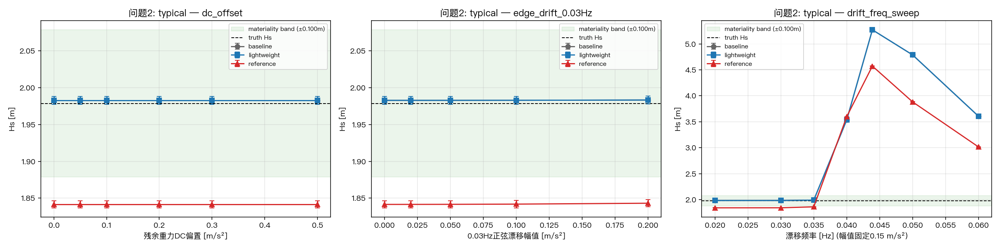
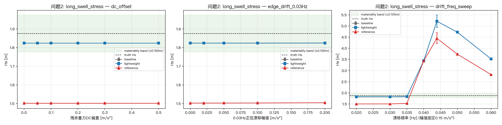
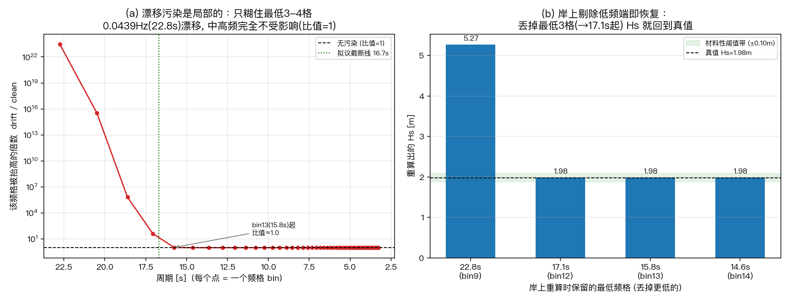
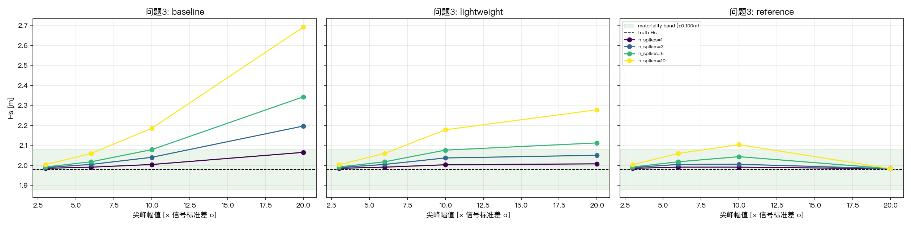
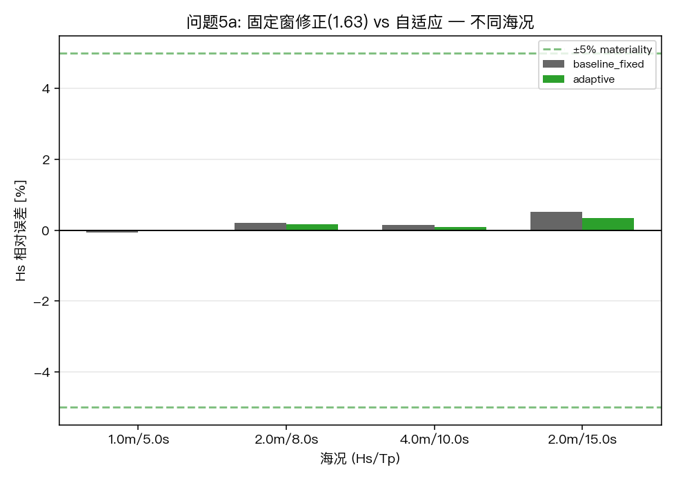
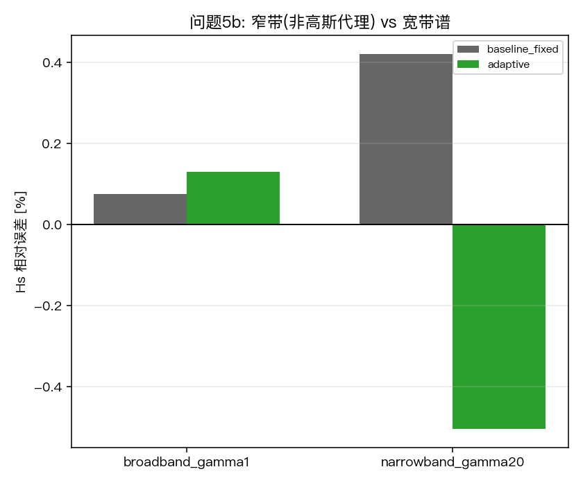
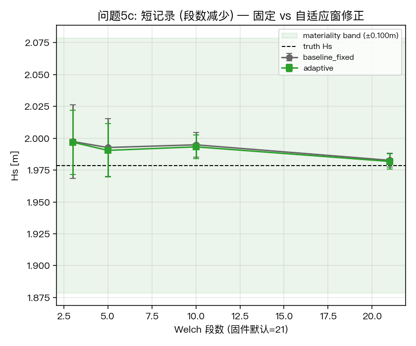
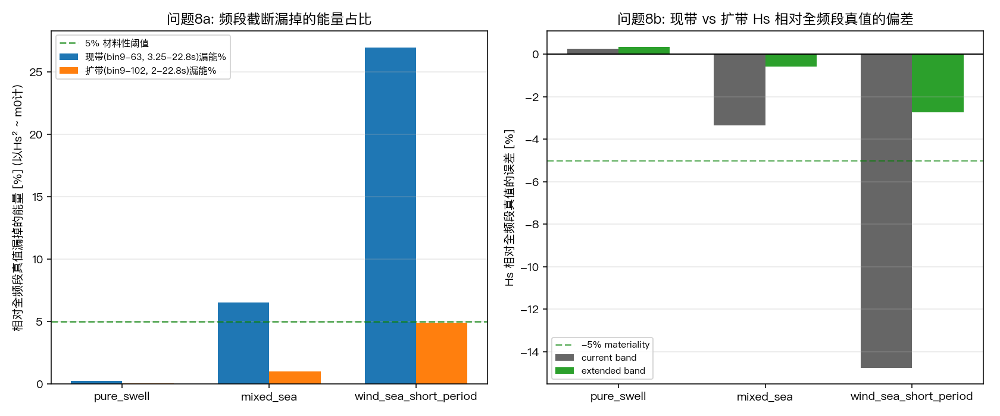

# 2. 波浪谱算法：问题清单与仿真结论

> **这是 wave_analyzer.cpp 波浪谱算法的权威状态文档——要跟踪算法可靠性，看这一份就够。** 它合并了两部分工作：①对照 SWIFT / NIWA WII 的可靠性**审计**（发现 8 类问题）；②对其中开放问题的**仿真定量验证**（问题会造成多大误差、值不值得改）。算法本身怎么工作，见 [`1.算法说明.md`](1.算法说明.md)。
>
> 最后更新 2026-07（含 §3.1.5 补充分析）。

## 阅读提示：可靠性标注

正文用两个标签区分"测出来的"和"我们的解释"：

- **【实测】** —— 直接来自仿真实验数据（N≥20 次随机重复的平均），最可靠，重跑代码可复现。
- **【推断】** —— 对"为什么会这样"的物理/工程解释，逻辑站得住但未独立验证，当作"最可能的解释"看待。

---

## 一页速览：8 个问题状态总表

| # | 问题                             | 材料性影响                            | 状态               | 解法在哪                                         | 详见  |
| - | -------------------------------- | ------------------------------------- | ------------------ | ------------------------------------------------ | ----- |
| 1 | Tz/Tc 公式分子分母写反           | 高（输出的是频率不是周期）            | ✅**已修复** | 固件（已改）                                     | §4.0 |
| 2 | 加速度转位移除 ω⁴ 放大低频漂移 | **高**（最坏 +166%）            | 已定位、有解       | **岸上后处理**（污染局部、可剔除恢复）     | §4.1 |
| 3 | 无逐段去尖峰                     | 低（多数场景阈下）                    | 可选              | 岸上/固件皆可                                    | §4.2 |
| 4 | 无结果合理性 QC                  | 中高（两类盲区各约 15–20% 且无预警） | 建议做             | 固件加轻量旗标 + 岸上细查                        | §4.3 |
| 5 | 窗修正系数用固定 1.63            | 很低（≤0.9%）                        | 维持现状           | 不需改                                           | §4.4 |
| 6 | 未输出谱峰周期 Tp                | 信息缺失                              | ✅**已修复** | 固件（已加字段）                                 | §4.0 |
| 7 | 只垂荡单点、无方向谱             | 范围限制（非错误）                    | 未做/未来          | 固件（需评估功耗算力）                           | §4.0 |
| 8 | 高频端只到 3.25s，短波盲区       | 场景相关（风浪天气 −14.7%）          | 建议改             | **固件**（扩 welch_bin_max，岸上无法补救） | §4.5 |

一句话总结：**问题8 必须固件改**（不算就永远没有）；**问题2 最好岸上处理**（谱已回传、污染局部、可剔除恢复）；**问题4 固件加轻量旗标、复杂质控留岸上**；**问题1/6 已修复**；**问题3/5/7 维持现状**。

---

## 摘要

`wave_analyzer.cpp` 是本浮标固件里把 IMU 测到的垂向加速度，转换成"有效波高 Hs、平均跨零周期 Tz、平均波峰周期 Tc、谱峰周期 Tp"这几个海况参数的核心算法。此前的审计（对照 SWIFT、NIWA WII 两个已发表浮标的处理方法）发现了 8 类可疑之处，其中问题 1（Tz/Tc 公式写反）和问题 6（缺 Tp 输出）已经直接改代码修复，并通过实际编译验证。

本报告用**计算机仿真**（不是真实海上数据）定量回答剩下几个问题："这些问题在实际海况下到底会造成多大的误差？值不值得为此改固件？"。核心结论：

- **问题2（加速度转位移的算法）影响最大，但没有简单的解决方案**——当传感器漂移的频率恰好落在算法保留的最低频率点附近时，波高会被算出来虚高 166%；而我们设计的"轻量修复方案"对这种漂移完全无效；参照 SWIFT 的"标准修复方案"虽然能防住漂移，但它自己在长涌浪天气下会把波高系统性地少算 20%。也就是说，两个修复方案都不完美，需要更细致的设计。
- **问题4（结果合理性检查）目前有两个盲区**：极端长周期涌浪和传感器信号削顶这两种情况，算出来的数字"看起来正常"，但实际上是错的，现有的检查规则抓不住。
- **问题8（新提出的：算法只能看到 3.25 秒以上的波浪）**在风浪较短的天气下会明显低估波高（最多少算 27% 的能量），扩大频段能明显改善，但在纯涌浪天气下则没有必要。
- **问题3（去掉信号里的异常尖峰）和问题5（窗函数修正系数）** 造成的误差都比较小，在多数场景下可以先不改。

---

## 1. 背景

本浮标（`omb-nano`，极地漂流浮标）用 IMU（惯性测量单元）测量海面的上下起伏（波浪），并把处理后的结果写入 SD 卡/串口输出（原设计经卫星）。核心算法在固件文件 `wave_analyzer.cpp` 中，此前已完成一轮"可靠性审计"——把这个算法和两个已发表、有科学文献支撑的浮标（SWIFT、NIWA WII）的处理方法逐项对比，发现的问题（问题 1–7）连同本轮仿真新增的"频段覆盖"问题 8，都已合并进本文档统一记录。

问题1（周期公式写反）和问题6（缺一个周期指标）已经在上一阶段直接改了代码，属于"改了就是对的"的确定性修复，已经过完整验证。剩下的问题2、3、4、5、8，性质不一样——它们不是"错不错"的问题，而是"在什么条件下、错多少"的问题，需要用仿真实验去量化，这就是本报告要做的事。

---

## 2. 基础概念与算法流程

本节原有的"海浪谱/Hs/Tz/ω⁴/Welch/谱矩"基础讲解，以及"浮标采集→处理→上传流程 + 传回的数据字段"，已统一移到 [`1.算法说明.md`](1.算法说明.md)（"一、基础概念"和"二、采集与上传流程"两节）。看不懂下面术语时回去查那份。

---

## 3. 数据与方法

这里概述关键方法点（完整的预注册决策与实验设计见下文各小节），帮助理解结果表格里的数字是怎么来的。

### 3.1 用"假数据"做实验：为什么这样做，以及局限

真实海上数据没有"标准答案"——你测到一段加速度，没有人告诉你"这段时间真实的 Hs 到底是多少"，所以没法直接检验算法对不对。本报告的做法是反过来：**先按照一个已知的、教科书标准的海浪谱形状（JONSWAP 谱）人为生成一段"假的"海面高度曲线，这样真实的 Hs/Tz/Tp 就是我们自己设定好、精确已知的**；再用物理公式算出这段海面对应的"理想加速度"，把这段加速度喂给算法，看算法算出来的结果和我们预先设定的"标准答案"差多少。

这个方法的好处是有精确的标准答案可以对照；局限是**目前用的都是合成信号，不是真实海况**——真实数据会有本仿真没有覆盖到的复杂性（比如多个海况混合、传感器噪声的真实统计特性等）。本报告设计时已经把"未来接入真实数据"的接口留好（见 §5.3），但本轮尚未执行。

### 3.2 baseline 复刻与验证

我们把固件里的算法逐行搬到了 Python 里（不改固件本身），然后先做了一次"验证关卡"：喂一个频率精确落在某个频率点上的单一正弦波信号进去，检查算出来的 Hs 和解析公式算出的标准答案差多少。**【实测】** 结果是相差仅 0.105%，说明这份 Python 复刻和固件用的数学换算（尤其是 FFT 的缩放约定）是一致的，后续所有结果都建立在这个已验证的基础上。

### 3.3 两版"修复方案"是怎么设计的

对问题2、3，我们各设计了两种修复思路，用来对比：

- **参照版**：完全照搬 SWIFT 浮标论文/代码里的做法（比如用滤波器去掉低频漂移、用统计方法剔除异常尖峰），代表"业界标准做法能做到多好"。
- **轻量版**：为本浮标实际用的单片机（Apollo3，算力和内存都很有限、靠电池供电）设计的简化版本，代表"实际能塞进固件、不显著增加功耗的方案能做到多好"。

问题5只设计了一版改进（自适应窗修正），因为它本身计算量就很小，不存在"太重跑不动"的顾虑。

### 3.4 材料性阈值：多大的误差才算"值得改"

为了避免"这个误差算大还是算小"变成事后各说各话，我们在跑实验**之前**就定死了判断标准（专业说法叫 pre-register）：

| 参数    | 超过这个数就算"材料性显著"（值得改）   |
| ------- | -------------------------------------- |
| Hs      | 偏差 > 5% 或 > 0.10 米（两者取较大的） |
| Tz / Tc | 偏差 > 0.5 秒                          |
| Tp      | 偏差 > 1 个频率格                      |

下文表格里的"是否材料性显著"这一列，都是严格按这套标准自动判定的，不是人工目测。

### 3.5 每次实验重复了多少次

每一种"海况+扰动强度"的组合，都用 20 个不同的随机相位重新生成信号跑一遍（振幅是按目标海况精确定好的，只有相位是随机的），报告里给出的是这 20 次的平均值——这样可以把"算法系统性偏差"和"这次数据碰巧比较特殊"这两件事分开看。

---

## 4. 结果

### 4.0 已修复问题（1、6）与范围限制（7）

这三个问题不需要仿真——问题1、6 是"改了就对"的确定性修复（已完成并通过 Docker 编译验证），问题7 是功能范围的说明。

**问题 1【已修复】：Tz/Tc 公式分子分母写反。**【理论/量纲】 审计发现固件字面计算的是 $T_z=\sqrt{m_2/m_0}$、$T_c=\sqrt{m_4/m_2}$，而标准定义是其**倒数** $\sqrt{m_0/m_2}$、$\sqrt{m_2/m_4}$。最硬的证据是量纲分析：$\sqrt{m_0/m_2}$ 量纲为秒（周期，正确），$\sqrt{m_2/m_0}$ 量纲为 1/秒（频率，错误）——所以原代码输出的"周期"实际是频率量纲，是隐蔽的系统性错误（数值 0.07–0.3 不报错、易被忽略）。**已直接改为 `tz = sqrt_m0/sqrt_m2; tc = sqrt_m2/sqrt_m4`**，公式与推导见 [`1.算法说明.md`](1.算法说明.md) §6.3。详细审计依据（含 SWIFT/NIWA 对照、量纲表）见本文档附录。

**问题 6【已修复】：未输出谱峰周期 Tp。**【事实】 审计发现固件已算出谱最大值但没记录对应频格，导致 `Wave_Packet` 缺 `Tp`。**已新增 `Tp` 字段**（在最大值查找循环里顺带记录 bin 索引换算），`print_wave_packet`/SD CSV 同步更新。注意 Tp 取的是**加速度谱**峰值（复用已有的量化基准查找），与 SWIFT/NIWA 在位移谱取峰略有差异——但这个选择恰好让 Tp 对低频漂移天然免疫（见 §4.1.5）。

**问题 7【范围限制，非错误】：只垂荡单点、无方向谱。**【事实】 固件全程只用 `accel_down` 一路；北/东两路水平加速度虽然算出来了但在存入前被丢弃（`DataEntry` 只有 `accel_down` 一个字段）。所以浮标输出的是一维垂向谱、不含浪向信息。SWIFT/NIWA 用多自由度数据出方向谱（Kuik 协谱法）。这不是错误，是功能未做——硬件（IMU）已具备扩展所需的全部原始信息，未来若要方向谱需评估功耗/算力/带宽预算。

---

### 4.1 问题2：加速度转海面高度（除以 ω⁴ 这一步）

**问题是什么**：[1.算法说明.md](1.算法说明.md) 讲过，频率越低，除以 ω⁴ 的放大倍数越夸张。固件在保留频率范围的最低点（对应周期约 22.8 秒）附近，理论上这个放大倍数能到约 172 倍。如果这个频率附近本来就混入了传感器的低频漂移噪声（不是真实的海浪信号），就会被放大成看起来很吓人的"假海浪"。固件目前对此没有任何针对性处理，只是简单减掉一个固定重力常数。

#### 4.1.1 纯粹的"零点偏移"其实问题不大

**【实测】** 先测试最简单的情况：给加速度信号加一个恒定不变的偏移量（模拟传感器零点没校准准，最大测到 0.5 m/s²）。结果三种处理方式（原始固件、轻量版、参照版）的 Hs 几乎都不受影响（如典型海况下，偏移 0.5 m/s² 时固件算出 1.983m，跟没有偏移时的 1.983m 几乎一样，偏差仅 0.2%）。

**【推断】** 这是因为算法在做傅里叶变换前会加一个"Hann 窗"（见 1.算法说明.md），这个窗函数对"频率恰好是 0"的恒定分量有很强的抑制效果，一个恒定偏移的能量几乎全部集中在最低频率点，衰减到保留频段最低的第 9 个格子时已经非常微弱，不足以对 Hs 产生看得见的影响。

#### 4.1.2 真正危险的是"振荡型"漂移，尤其是频率恰好落在保留频段边缘时

**【实测】** 如果这个漂移不是恒定的，而是像正弦波一样缓慢振荡（模拟传感器随温度、姿态缓慢变化的真实漂移），结果就完全不同了。固定振荡幅度 0.15 m/s²（和典型海况下真实波浪加速度的量级相当），扫描振荡频率：

| 漂移频率                               | 真实Hs(标准答案) | 固件算出的Hs     | 偏差                          |
| -------------------------------------- | ---------------- | ---------------- | ----------------------------- |
| 0.020 Hz                               | 1.979m           | 1.983m           | +0.2%（不显著）               |
| 0.030 Hz                               | 1.979m           | 1.983m           | +0.2%（不显著）               |
| 0.035 Hz                               | 1.979m           | 1.990m           | +0.6%（不显著）               |
| **0.040 Hz**                     | 1.979m           | **3.533m** | **+79%（材料性显著）**  |
| **0.0439 Hz（=保留频段最低点）** | 1.979m           | **5.271m** | **+166%（材料性显著）** |
| 0.050 Hz                               | 1.979m           | 4.788m           | +142%（材料性显著）           |
| 0.060 Hz                               | 1.979m           | 3.607m           | +82%（材料性显著）            |

**【推断】** 这条曲线精确验证了 上面说的机理：漂移频率越接近保留频段的最低点（0.0439 Hz），ω⁻⁴ 放大效应越强，Hs 被夸大得越厉害；一旦漂移频率落到保留频段之外（比如 0.02、0.03 Hz），Hann 窗又能把它较好地滤掉，影响很小。也就是说，**危险区间很窄，但一旦踩中，误差可以大到离谱**（166% 意味着算出来的浪比真实情况大了一倍还多）。图见 [problem2_typical.png](../analysis/wave_spectrum_validation/outputs/figures/problem2_typical.png)（右侧面板即为此扫描）。

{width="100%"}
*图注：三个面板都是典型海况（Hs=2m/Tp=8s），纵轴为算出的有效波高 Hs[m]，绿色带 = 材料性阈值带（真值±0.10m），黑色虚线 = 真值；灰=原始固件、蓝=MCU轻量版、红=SWIFT参照版，误差棒为 20 次随机相位实现的 95% 置信区间。（左）横轴=纯直流零点偏移量[m/s²]：三种方法几乎不动，说明恒定偏移对 Hs 无影响。（中）横轴=0.03Hz 正弦漂移的幅值[m/s²]：仍几乎不动，因 0.03Hz 落在保留频段之外、被窗函数滤掉。（右）横轴=漂移频率[Hz]（幅值固定 0.15m/s²）：一旦漂移逼近保留频段最低点（0.0439Hz），Hs 暴涨到 5.27m（+166%）——这就是问题2 的"危险区"。*

在长涌浪的极端天气工况（波浪周期长达22秒，谱峰本身就贴着保留频段边缘）下，同样的实验重复一遍，结论方向一致但更严重——见图 [problem2_long_swell_stress.png](../analysis/wave_spectrum_validation/outputs/figures/problem2_long_swell_stress.png)。

{width="100%"}
*图注：与上图完全相同的三组实验，但海况换成长涌浪压力工况（Tp=22s，谱峰本身就贴着保留频段最低端）；坐标轴、配色、误差棒含义同上图。结论方向一致但更严峻——注意红色（SWIFT参照版）即使在零扰动（各面板最左端）也已把 Hs 系统性低估约 20%，因为它的高通滤波会误伤贴近低频端的真实长涌能量（详见 §4.1.4）。*

#### 4.1.3 "轻量修复方案"对这种漂移完全没用

**【实测】** 在上表 0.0439 Hz 这个最危险的频率点上，轻量版（逐段做一次"拉直线去掉趋势"的处理）算出的 Hs 是 5.271m，跟完全不修复的固件（5.271m）几乎一模一样，没有任何改善。

**【推断】** 原因在于轻量版用的"去趋势"方法，本质上只能移除一段数据里"整体往上斜"或"整体往下斜"这种单调变化，而 0.0439 Hz 的振荡在一小段（204.8秒）数据里已经完整振荡了大约 9 个周期——这是一个真正的"波浪"，不是"趋势"，一条直线拟合完全抓不住它、也去不掉它。**这是本报告一个比较重要的负面结论：简单的逐段去趋势，对这类频率贴近保留频段的振荡型漂移是无效的，不能指望靠它解决问题2最危险的那部分情况。**

#### 4.1.4 "参照修复方案"能防住漂移，但自己在长涌浪天气下会犯新的错误

**【实测】** 参照版（照搬 SWIFT 的做法：先用高通滤波器滤掉低频成分，再做两次积分把加速度变成位移）确实能部分抵御上述漂移——在 0.0439 Hz 危险点上，参照版算出 4.572m，比不修复的 5.271m 好一些，但离真实的 1.979m 还差得远（仍然材料性显著）。

更让人意外的是，**【实测】** 即使完全没有任何漂移、信号很"干净"的情况下，参照版本身就已经系统性地把 Hs 算低了：典型海况下低估 6.9%（算出 1.842m，真实 1.979m），而在长涌浪压力工况下低估幅度扩大到 **19.9%**（算出 1.502m，真实 1.875m）——远超材料性阈值。

**【推断】** 这是因为参照版用的高通滤波器不是一把"理想的手术刀"，即使把滤波器的截止频率特意调低（本仿真用了 0.03Hz，低于保留频段最低点），滤波器本身的"过渡带"仍然会把一部分紧邻截止频率之上（也就是保留频段低端）的**真实波浪能量**一并衰减掉。恰好长涌浪的谱峰频率本来就贴近保留频段低端，所以这种"误伤"在长涌浪天气下最严重——**问题2本来最关心的就是长涌浪场景，而参照版恰恰在这个场景下表现最差**。这提醒我们，参照版不是"哪里都更好"的万能解，它是把"被漂移放大"的风险换成了"把真实长涌能量滤掉"的风险，两种风险在不同场景下互有胜负，不能简单说"用参照版就完事了"。

#### 4.1.5 补充分析：漂移污染是"局部的"，而且可以在岸上剔除后完全恢复

前面 4.1.2–4.1.4 说明"固件里没有好办法"。但换个思路问：漂移到底糊住了谱的哪一部分？会不会只糊住低频那一小块、其它频段还是干净的？如果是，那 [1.算法说明.md](1.算法说明.md) 讲过浮标传回的是**整条逐格谱**，岸上完全可以把糊掉的那几格丢掉、用剩下干净的部分重算。为回答这个，补做了一组针对性仿真（最坏情况漂移：0.0439Hz=保留频段最低格、幅值 0.15 m/s²，叠加在典型风浪 Hs=2m/Tp=8s 上，N=20 相位平均）。

**发现一：污染是局部的，只糊住最低 3–4 个频格。**【实测】 逐格看漂移把每个频格抬高了多少倍：

| 频格 bin     | 周期    | 被抬高倍数       |                          |
| ------------ | ------- | ---------------- | ------------------------ |
| 9            | 22.8s   | 天文数字         | ← 漂移正落在这格        |
| 10           | 20.5s   | ~3×10¹⁵       |                          |
| 11           | 18.6s   | ~70万            |                          |
| 12           | 17.1s   | 42×             |                          |
| **13** | 15.8s   | **1.05×** | ← 基本干净              |
| 14 及以上    | ≤14.6s | **1.00×** | ←**完全不受影响** |

也就是说，漂移的能量只堆在它自己那一格附近（外加窗函数少量旁瓣泄漏到相邻 2–3 格），**中高频（真正装着风浪、短波信息的那一大片）纹丝不动**。这和尖峰（问题3，能量全频段扩散）本质不同。

**发现二：对四个参数影响很不一样。**【实测】（全现带 bin9-63）：

| 参数         | 真值   | 有漂移算出 | 偏差                         | 为什么                                                                        |
| ------------ | ------ | ---------- | ---------------------------- | ----------------------------------------------------------------------------- |
| Hs           | 1.979m | 5.271m     | **+166%**              | m0（谱下总面积）被 ω⁻⁴ 放大的低频那几格主导                                |
| Tz           | 6.71s  | 14.37s     | **+114%（偏长）**      | m0 暴涨、但 m2 因"按频率平方加权"压低了低频贡献 → √(m0/m2) 被拉长           |
| Tc           | 5.72s  | 7.00s      | +22%（仍超阈）               | 用 m2/m4，高频加权压掉大部分低频，但没压尽                                    |
| **Tp** | 7.88s  | 7.85s      | **−0.4%（几乎免疫）** | Tp 取的是**加速度谱**峰值，漂移在加速度谱上只是个小尖、压不过真实风浪峰 |

（Tp 免疫是个意外好处：问题6 当初把 Tp 定义成"加速度谱取峰"，恰好让它对低频漂移不敏感。）

**发现三：岸上丢掉最低几格，四个参数全部恢复。**【实测】 从"有漂移的传输谱"出发，岸上重算时把最低几格排除掉再算：

| 岸上保留的最低格            | 起始周期 | 重算 Hs         | vs 真值         | Tz    | Tc   | Tp   |
| --------------------------- | -------- | --------------- | --------------- | ----- | ---- | ---- |
| bin9（不排除）              | 22.8s    | 5.271           | +166%           | 14.37 | 7.00 | 7.85 |
| **bin12（丢掉9-11）** | 17.1s    | **1.983** | **+0.2%** | 6.73  | 5.73 | 7.85 |
| bin13                       | 15.8s    | 1.983           | +0.2%           | 6.73  | 5.73 | 7.85 |

**只丢掉最低 3 格（bin 9-11），Hs/Tz/Tc/Tp 就全部回到干净值。** 且因为这个风浪在 17-22.8s 本来就几乎没有真实能量，丢掉这几格零损失。

{width="90%"}
*上图：(a) 纵轴对数坐标显示每个频格被漂移抬高的倍数，从最低格的天文数字断崖式跌到 bin13(15.8s) 以上的 1.0（无污染），证明污染高度局部化；绿色虚线为拟议的 16.7s 截断线。(b) 从含漂移的谱在岸上重算 Hs：保留全部频格时虚高到 5.27m，丢掉最低 3 格（保留 17.1s 以内）后立即回到真值 1.98m（落进绿色材料性阈值带）。*

**这一节的结论（战略性）**：低频漂移是一个"局部、可逆、岸上可修"的问题——污染只到 bin12(17.1s)、中高频全干净、Tp 天然免疫，而浮标回传整条谱使"岸上剔除坏格重算"完全可行。**因此问题2 不必在固件里硬扛（截断或高通都有副作用），更合理的分工是：固件照常传回整条谱，把漂移的识别与剔除放到岸上后处理**——而且岸上最好做**自适应剔除**（检测低频端的异常尖峰、动态丢掉受影响的格子），而不是在固件里写死一个固定截断频率。这与"固件算力有限、复杂质控留给后期数据分析"的思路一致。

> **⚠️ 前提提醒**：既然有漂移时机上算的 Hs/Tz/Tc 不可信（它们是在整条含污染的谱上算的），那么**机上传回的这三个标量只能当"快速一览"，权威值必须岸上从 `array_pwelch` 重算**。Tp 例外，机上值已经可信。

### 4.2 问题3：信号里混入异常尖峰（去尖峰）

**问题是什么**：如果 IMU 因为通信错误、震动冲击等原因偶尔冒出一两个异常大的读数（"尖峰"），固件目前没有任何检测和剔除机制。

**【实测】** 在典型海况下，测试了尖峰数量（1~10个）和尖峰幅值（3~20倍于信号自身的波动幅度）的组合：

- 尖峰数量少（≤5个）、幅值不算特别夸张（≤10倍）的情况下，固件算出的 Hs 偏差都在材料性阈值以内，不构成显著问题。
- 只有"数量多（10个）+幅值大（10~20倍）"同时出现时才会材料性显著，最坏情况下 Hs 被夸大 36%（算出 2.692m，真实 1.979m）。
- 参照版（全局统计检测+剔除）在这种最坏情况下几乎能完全纠正回来（偏差仅 0.2%）；轻量版（逐段就地限幅）也有明显改善（偏差降到 15.1%），但不如参照版彻底。

**【推断】** 有一个反直觉的细节：尖峰幅值恰好等于检测算法用的判断门槛（10倍标准差）时，效果反而不如幅值更大（20倍）的尖峰稳定——这是"卡在门槛边缘"的典型效应：幅值远超门槛的尖峰能被稳定、干净地识别出来并纠正；幅值刚好在门槛附近的尖峰，会因为数据本身的随机波动，有时候被抓到、有时候抓不到，表现就不稳定。这提示如果将来真的要实现去尖峰功能，判断门槛的选取需要留有余量，不能卡得太死。

{width="100%"}
*图注：三个面板从左到右分别是原始固件、MCU轻量版（逐段就地限幅）、SWIFT参照版（全局10σ检测剔除）。横轴 = 单个尖峰的幅值（以信号自身标准差 σ 为单位），纵轴 = 算出的 Hs[m]，线条颜色由浅到深代表尖峰数量（1→10 个），绿色带 = 材料性阈值带、黑色虚线 = 真值。可见只有"尖峰数量多且幅值大"（深色线的右端）时，原始固件（左）才把 Hs 明显抬高；参照版（右）几乎把所有情形都压回真值附近。*

**结论**：多数现实场景下，问题3造成的误差可以接受，优先级低于问题2。只有在预期会频繁出现密集、大幅尖峰（比如振动环境特别恶劣）的部署场景下，才有必要专门处理。

### 4.3 问题4：结果合不合理的自动检查（QC）

**问题是什么**：固件算出 Hs/Tz/Tp 之后，不管数字是否物理上合理，都直接打包发送，没有任何"这个结果看起来不太对劲"的把关机制。

我们设计了几种"应该被抓出来"的异常输入，检验一套简单的检查规则（Hs 超过 8 米就报警、Tp 超出 2~25 秒范围就报警）能不能发现问题：

**【实测】** 明显的异常确实能被抓住——注入一个 Hs=12 米的极端大浪，算法正确算出约 11.9~12.0 米并触发"Hs 过大"警报；输入一段完全没有波浪的平静信号，正确算出 Hs=0 并触发"结果无效"警报。

但**【实测】** 有两类情况会"蒙混过关"——算出来的数字看起来完全正常，但其实是错的：

1. **超长周期涌浪（周期30秒，远超保留频段）**：这种海况真实设定的 Hs 是 2 米，但由于保留频段完全看不到这么长周期的波浪，算法只能看到"漏网之鱼"般的少量残余能量，算出 Hs≈1.02~1.04 米、周期约 16~20 秒——两个数字单独看都很"正常"，没有触发任何警报，但实际上真实海况被严重低估了（约 74% 的真实能量完全不可见）。
2. **传感器信号削顶（模拟硬件故障导致信号被限幅）**：典型海况下真实 Hs 是 1.979 米，削顶后算出 1.582 米（低估 20%，材料性显著），同样没有触发任何现有警报。

**【推断】** 现有的检查规则只盯着"结果数字本身是否在合理范围内"，但这两类失效模式的共同特点是：**结果数字看起来在合理范围内，问题出在"输入信号本身已经失真，但失真后的输出恰好还落在正常范围里"**。要抓住这类问题，可能需要新增不同类型的检查，比如"保留频段边缘的能量占比是否异常集中"（可能提示超长周期涌浪被截断）、"原始信号是否出现长时间贴着某个数值不变"（可能提示传感器削顶或卡死）。这两类新规则目前都还没有设计和验证，只是本报告识别出的一个方向性建议。

（结果表格）

| 测试场景                         | 真实Hs                                        | 算出的Hs     | 算出的Tp     | 现有QC是否报警            |
| -------------------------------- | --------------------------------------------- | ------------ | ------------ | ------------------------- |
| 极端大浪 (Hs=12m)                | 11.92m                                        | ~11.9~12.0m | ~8.9s        | ✅ 报警（Hs过大）         |
| 超长涌浪 (周期30s，超出保留频段) | 1.02m*(仅为截断后的可见部分，真实设定是2m)* | ~1.02~1.04m | ~16.4~18.6s | ❌ 未报警，但结果严重低估 |
| 完全平静无波浪                   | 0m                                            | 0m           | —           | ✅ 报警（结果无效）       |
| 传感器信号削顶                   | 1.979m                                        | 1.582m       | 7.88s        | ❌ 未报警，但偏差20%      |

### 4.4 问题5：窗函数的能量修正系数

**问题是什么**：[1.算法说明.md](1.算法说明.md) 提到加窗会损失一部分能量，需要一个系数补偿回来。固件用的是一个固定的经验系数（1.63），而参照做法是每一小段数据单独实时算一个"刚好补回原始能量"的系数。

**【实测】** 在四组不同海况、窄频谱 vs 宽频谱（用来模拟波形更"尖"或更接近正弦波的极端情况）、以及数据量减少到只有 3~10 段（模拟采集时间被压缩）的所有测试场景下，固定系数和自适应系数算出的 Hs 差异全部在材料性阈值以内，观察到的最大差异只有约 0.9%（出现在窄频谱这个极端场景）。

**【推断】** 这说明固定系数 1.63 本身已经是一个足够好的近似，在本仿真覆盖的场景范围内，没有发现值得为此专门增加运行时计算量的理由。这是本次几个问题里结论最干脆的一个。

{width="70%"}
*图注 5a：横轴 = 四组不同海况（标注为 Hs/Tp），纵轴 = Hs 相对误差[%]；灰柱 = 固件的固定系数 1.63、绿柱 = 逐段自适应方差修正，绿色虚线 = ±5% 材料性阈值。所有柱都远在 ±5% 以内，两种做法差异可忽略。*

{width="70%"}
*图注 5b：横轴 = 宽频谱（γ=1，能量分散）与窄频谱（γ=20，能量集中、更接近单频/非高斯的极端谱形），纵轴同为 Hs 相对误差[%]、配色同 5a。即便在窄频谱这个最不利谱形下，固定与自适应系数的差异也不足 1%。*

{width="70%"}
*图注 5c：横轴 = Welch 平均所用的段数（固件默认 21，依次减到 3，模拟采集时间被压缩的短记录），纵轴 = 算出的 Hs[m]，绿色带 = 材料性阈值带、黑色虚线 = 真值；灰=固定系数、绿=自适应。段数减少会让估计更"毛躁"，但两种系数始终都落在阈值带内、且彼此几乎重合。*

### 4.5 问题8：算法能"看到"的最短波浪周期

**问题是什么**：固件目前只保留 3.25 秒到 22.8 秒周期范围内的波浪信息，比参照浮标（能看到 1 秒周期）窄不少，短周期的风浪部分完全看不见。这不是"错误"，是设计取舍——扩大范围要多占内存和卫星传输流量（每包多约 78 字节）。本报告评估这个取舍到底值不值。

**【实测】** 结果和海况类型强相关：

| 海况类型   | 波浪主周期 | 现有频段(到3.25秒)漏看的能量占比 | 扩大到2秒后漏看的能量占比 | Hs是否因此被材料性低估                                      |
| ---------- | ---------- | -------------------------------- | ------------------------- | ----------------------------------------------------------- |
| 纯涌浪     | 14秒       | 0.23%                            | 0.03%                     | 否（现有范围已经够用）                                      |
| 混合浪     | 6秒        | 6.5%                             | 1.0%                      | 否（贴近阈值边缘，未超标）                                  |
| 短周期风浪 | 4秒        | **27.0%**                  | 4.9%                      | **是**（现有范围低估14.7%，扩大后降到2.7%，不再显著） |

**【推断】** 波浪周期越短，越容易被现有的 3.25 秒截止线挡在外面，所以纯涌浪天气几乎不受影响，而短周期风浪天气下问题就很突出——现有算法会把这类海况的波高明显低估，扩大频段能明显改善（低估幅度从14.7%降到2.7%）。极地浮标全年会经历各种海况，不会永远只有纯涌浪，所以从"能不能覆盖到真实会遇到的所有天气"这个角度看，扩大频段这项改动整体上是有正当性的，只是在纯涌浪为主的季节/海域收益不明显。

{width="90%"}
*图注：（左）横轴 = 三种海况，纵轴 = 相对全频段真值漏掉的能量占比[%]（按 Hs²∝m0 计），浅色柱 = 现有频段（上限 3.25s）、深色柱 = 扩带到 2s 后，绿色虚线 = 5% 材料性阈值。（右）横轴同为三种海况，纵轴 = 现带/扩带各自算出的 Hs 相对全频段真值的偏差[%]。可见短周期风浪下，现有频段漏掉高达 27% 的能量、Hs 被显著低估，扩带到 2s 后漏能降到 <5%、不再显著；而纯涌浪下现有频段已经够用。*

---

## 5. 讨论

### 5.1 汇总对比：哪个问题最值得优先处理

| 问题                | 材料性影响                                 | 是否有现成的好修复方案                                                                    | 建议优先级                                                                               |
| ------------------- | ------------------------------------------ | ----------------------------------------------------------------------------------------- | ---------------------------------------------------------------------------------------- |
| 问题2（漂移放大）   | **高**（最坏情况+166%）              | 固件里没有（轻量版无效、参照版换新偏差）；**但污染局部、可岸上剔除恢复（§4.1.5）** | **最高，但解法在岸上不在固件**——固件只需照常传回整条谱，识别与剔除放到岸上后处理 |
| 问题4（QC盲区）     | 中高（两个盲区各约15-20%偏差且完全无预警） | 部分——需要新增规则类型，不是调整现有阈值就够                                            | 高——即使不修算法本身，加一层预警也能避免"错误结果被当真"的风险                         |
| 问题8（频段覆盖）   | 场景相关（风浪天气下达14.7%）              | 有——扩大`welch_bin_max` 即可，代价是每包+78字节                                       | 中——建议采纳，收益和代价都清楚                                                         |
| 问题3（去尖峰）     | 低（多数场景内不显著）                     | 有（参照版效果好）                                                                        | 低——除非预期部署环境振动/干扰特别多                                                    |
| 问题5（窗修正系数） | 很低（最大0.9%，均不显著）                 | 不需要                                                                                    | 最低——建议维持现状                                                                     |

### 5.2 给固件改进的具体建议

- **问题2**：**建议放到岸上后处理，固件端不做特殊处理**（§4.1.5 补充分析支持）。理由：漂移污染只集中在最低 3–4 个频格、中高频完全干净，而浮标本来就回传整条逐格谱，所以岸上完全可以识别并丢掉受污染的低频格、用干净部分重算——实测丢掉最低 3 格即把 Hs 从虚高的 5.27m 恢复到真值 1.98m。固件里那两种修复（截断、高通）都有副作用（轻量版无效、参照版误伤长涌能量），反而不如不做。固件唯一需要保证的是**照常把整条 `array_pwelch` 传回**、并且下游明确知道"有漂移时机上的 Hs/Tz/Tc 只是快速一览、须岸上重算"。岸上的剔除最好是**自适应**的（检测低频端异常尖峰、动态定位受污染的格子），而不是写死一个固定截断频率——因为真实漂移落在哪个频率还需实测（见 §5.3）。
  - **要不要为岸上额外传一条"不确定性/置信度谱"？** 对**这个（稳态低频漂移）问题**：不需要。稳态漂移在 21 个 Welch 段里是一致出现的，所以"逐格段间方差"这类置信度指标并不能把它和真实窄带涌浪区分开；而漂移在**加速度谱形状**上本身就是低频端一个不合理的凸起，岸上光凭已回传的整条谱就能靠谱形识别。真正值得考虑的低成本增量是：①一个**每条记录的标量 QC 旗标**（如"最低几格能量占总能量的比例"，接近零成本，用来标记"这条记录疑似受污染、需岸上细看"）；②只有当**瞬态/间歇性**污染（间歇尖峰、非稳态漂移）在实测数据里确实成为问题时，才值得加一条"逐格段间方差"通道（它能标出只在部分段里出现的异常，但会让谱数据量翻倍）。由于本版 PCB 已移除铱星、数据出口是 SD 卡/串口，字节开销不再敏感，这些增量在硬件上是可行的——但建议**先用实测数据确认真实污染的形态，再决定加不加**，不要提前写死。
- **问题4**：建议优先做——即使暂时不改变谱估计算法，给最终结果加一层"这个数字有没有可能是不可信的"的旗标（例如低频端能量占比异常、原始信号出现异常平坦段），成本低、见效快，能避免"错误结果被下游当作正常数据使用"的风险。
- **问题8**：建议采纳，把 `welch_bin_max` 从 64 扩大到 103（即保留频段上限从3.25秒扩到2秒），并同步扩充传输包格式（每包增加约78字节，需确认卫星通信预算能接受）。（问题 8 已并入本文档统一记录。）
- **问题3、5**：建议暂不改动，除非未来实际部署中观察到振动/尖峰确实频发，或者要更新为更宽的保留频段（问题8）后重新评估窗修正系数的影响是否有变化。

### 5.3 局限性

- 本报告全部结论基于**合成信号仿真**，不是真实海上数据。真实数据会有本仿真未覆盖的复杂性（比如多个海况同时叠加、传感器噪声的真实统计特性、真实的机械振动谱等）。
- **问题2 的漂移是人为放在 0.04–0.06Hz 的压力测试，不代表真实漂移的频率分布。** 真实的热漂移/倾斜漂移通常慢得多（<0.02Hz、周期>50秒），那样会像恒定偏移一样被 Hann 窗直接滤掉、几乎无害；只有当真实漂移恰好落在保留频段最低端附近时，§4.1.5 的放大才会发生。**真实漂移到底落在什么频率、有多强，必须用水池/现场的 IMU 静置数据实测一条真实漂移谱来确认**——这也是为什么 §5.2 建议岸上做"自适应"剔除、并在拿到实测数据前不要把任何频率写死。换句话说，等真实数据回来重新分析后，问题2 的严重程度和最优处理方式都可能调整。
- 问题2 参照版用的滤波器截止频率（0.03Hz）是本仿真为了让对比更公平而刻意选定的，不完全等同于 SWIFT 论文原文的设定（0.05Hz）；这是有意为之的方法学选择，但意味着"参照版"这个称呼描述的是"同一类思路"，不是对 SWIFT 原始实现的逐字复刻。
- 部分谱矩量（尤其是全频段范围下的 Tc）在数学上不是良态的（因为标准海浪谱模型的高频尾部会导致相关积分发散），本报告已避免用它作为主要判断依据。

---

## 6. 总结与后续工作

问题1、6已经修复完成；本报告用仿真定量确认了问题2、3、4、5、8各自的影响大小和材料性。一个贯穿性的结论是**"哪些该在固件里改、哪些该留给岸上"**：问题8（短波盲区）**必须固件改**（`welch_bin_max` 64→103），因为固件不算那部分谱就永远没有、岸上无法补救；问题2（低频漂移）**最好留给岸上**（§4.1.5：污染局部、整条谱已回传、剔除低频端即恢复），固件里硬扛反而有副作用；问题4（QC盲区）建议固件加一层低成本旗标、复杂质控留给岸上；问题3、5 可维持现状。

已经设计好但本轮**没有执行**的后续工作：把仿真里用的通用数据接口（`load_accel_series`）对接到真实的 SWIFT/NIWA 浮标数据上，用真实海上数据复核本报告的结论（SWIFT 提供25Hz原始加速度，可以直接喂给同一套分析代码；NIWA 只有2Hz的位移数据，覆盖频段有限，作为次要来源）。这部分的接口已在代码里留好（`data_loaders.py` 的 SWIFT/NIWA stub），等待后续启动。

---

## 附录：审计依据（对照 SWIFT / NIWA WII）

本节保留最初"可靠性审计"阶段的对照证据，供追溯。审计把 wave_analyzer.cpp 与两个有科学文献支撑、有完整开源 MATLAB 代码的浮标逐项对比：**SWIFT**（IMU+GPS，加速度时域积分路径）、**NIWA WII**（heave+roll+pitch 直接测量）。另有 WaveBuoy、AWAC 两个浮标仅有厂商/外部预处理产物、无法逐行对比，仅记录在案。

### A. 已核实一致、无需修改的部分

| 项目                   | omb-nano 实现                                                                             | 参照实现                            | 结论            |
| ---------------------- | ----------------------------------------------------------------------------------------- | ----------------------------------- | --------------- |
| Welch PSD 单边谱归一化 | $S(f)=\dfrac{2E}{N^2\Delta f}$，因 $N^2\Delta f=Nf_s$，等价于 $\dfrac{E}{(N/2)f_s}$ | SWIFT/NIWA`mean(...)/(win/2*fs)`  | ✅ 数学形式一致 |
| 分段重叠率             | 75%（`fft_overlap=512` 为步进，N=2048）                                                 | SWIFT/NIWA 75%（步进=0.25×窗长）   | ✅ 一致         |
| 有效波高公式           | $H_s=4\sqrt{m_0}$                                                                       | SWIFT/NIWA`Hs=4*sqrt(sum(E)*Δf)` | ✅ 一致         |
| 保留频段下限量级       | bin 9 ≈ 0.044 Hz（≈22.8s）                                                              | SWIFT/NIWA 0.05 Hz（20s）           | ✅ 同量级       |
| 强制加窗               | `static_assert` 强制 Hann/Hamming                                                       | SWIFT/NIWA 均加窗                   | ✅ 理念一致     |

### B. 各问题的参照做法（审计原始依据）

- **问题2** SWIFT `rawdisplacements.m`：3 阶椭圆高通（截止 0.05Hz）+ `cumtrapz` 时域双重积分 + 每次积分前后高通 + 丢首尾 50s 瞬态。NIWA 直接测 heave 无此问题。
- **问题3** SWIFT `GPSwaves_v2.m`：`Nstd=10`，`abs(detrend(u))>=10*std(u)` 的点替换为均值（10σ 全局去尖峰）。
- **问题4** SWIFT/NIWA `run_wii.m`：`Tp>20s → Hs/Tp/Dp 置 NaN`；`Hs>4m → 标记`（疑似海冰）。
- **问题5** SWIFT/NIWA `process.m`：逐窗 `factu=sqrt(var(orig)/var(tapered))` 自适应方差修正（非固定系数）。
- **问题1/6** SWIFT/NIWA 用 `Tp=1/f_peak` 与能量加权 `Te=1/f_e`（$T_{m01}$），并未直接用 $T_{m02}=\sqrt{m_0/m_2}$——所以问题1 的判定靠量纲分析而非数值对照。

### C. 参照来源文件（用户 Google Drive）

- SWIFT：`.../Data analysis/SWIFT/` 及 `2015 arctic cruise/.../my processed wave data from swift/{GPSwaves_v2.m, rawdisplacements.m, reprocess_IMU_spectrafromrawdisplacements.m, MEM_directionalestimator.m}`
- NIWA WII：`.../Data sources_Buoy data/NIWA_WII_buoy/.../NIWA WII buoy/{run_wii.m, process.m, get_NIWA.m}`
- 总览：`.../Data sources_Buoy data/README_raw_motion_processing_buoys.md`
- 仿真代码与图数据：`omb-nano/analysis/wave_spectrum_validation/{code/, outputs/}`
